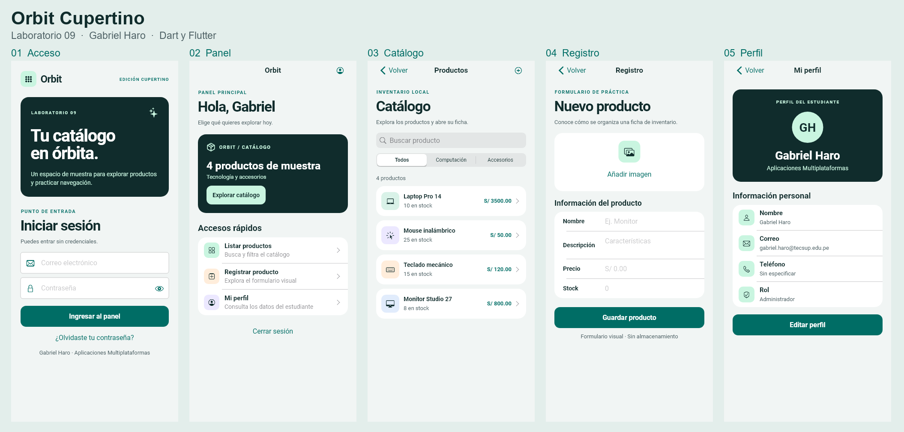

# Orbit Cupertino

**Gabriel Haro · Aplicaciones Multiplataformas · Laboratorio de las semanas 11–12**

Orbit es un catálogo de productos desarrollado en Dart y Flutter para practicar los widgets Cupertino. Incluye cinco pantallas: acceso, menú, catálogo, registro y perfil. El ingreso es simulado y los datos son de muestra; no hay backend, autenticación real ni almacenamiento.



## Cómo ejecutarlo

Con Flutter estable y Dart 3.10 o posterior:

```sh
flutter pub get
flutter run -d chrome
```

Para Android, elige un dispositivo de `flutter devices` y cambia `chrome` por su identificador. Cupertino es una biblioteca de Flutter: en esta entrega su interfaz se puede demostrar en web, aunque imite los controles de iOS.

## Widgets y estructura del laboratorio

| Parte | Implementación |
| --- | --- |
| Aplicación y tema | `CupertinoApp`, mapa de rutas y `CupertinoThemeData`. |
| Estructura y regreso | `CupertinoPageScaffold`, `CupertinoNavigationBar` y `CupertinoNavigationBarBackButton`. |
| Acceso y acciones | `CupertinoTextField` y `CupertinoButton.filled`. |
| Menú y perfil | `CupertinoListSection.insetGrouped` con `CupertinoListTile.notched`. |
| Catálogo | `ListView.separated`, `CupertinoSearchTextField` y `CupertinoSlidingSegmentedControl`. |
| Registro | `CupertinoFormSection.insetGrouped` y `CupertinoTextFormFieldRow`. |
| Mensajes y detalle | `CupertinoAlertDialog` y `CupertinoActionSheet`. |
| Tarjetas | Componente propio `TarjetaOrbit` compuesto por `ClipRRect`, `ColoredBox` y `Padding`. |

Los widgets de base como `ListView`, `Text`, `Row` y `Column` son comunes a Flutter. La interfaz no importa la biblioteca Material ni utiliza el widget Material `Card`.

## Demostración

1. Pulsa **Ingresar al panel** sin completar el formulario.
2. Abre **Listar productos**, elige **Accesorios** y escribe **mouse**. Toca el resultado para ver su ficha.
3. Usa el botón **+** del catálogo y pulsa **Guardar producto**. Aparece un aviso y el catálogo sigue sin cambios.
4. Regresa al menú, entra a **Mi perfil** y prueba **Editar perfil**. Para terminar, pulsa **Cerrar sesión**.

Consulta la [explicación del código](docs/EXPLICACION.md), la [captura de búsqueda](docs/capturas/06-busqueda.png) y el [aviso de registro](docs/capturas/07-aviso.png).

## Verificación

```sh
flutter analyze
flutter test
flutter build web --release
```

Las pruebas recorren las rutas, comprueban los filtros, verifican el aviso de registro sin almacenamiento y comparan siete capturas. También comprueban la navegación en ventanas de 320 × 640 y 1440 × 900. Para actualizar deliberadamente las referencias visuales, ejecuta `flutter test --update-goldens`.

## Referencias

- [CupertinoApp y rutas](https://api.flutter.dev/flutter/cupertino/CupertinoApp-class.html)
- [CupertinoListTile](https://api.flutter.dev/flutter/cupertino/CupertinoListTile-class.html)
- [Licencia de Roboto](assets/fonts/roboto_license.txt)
